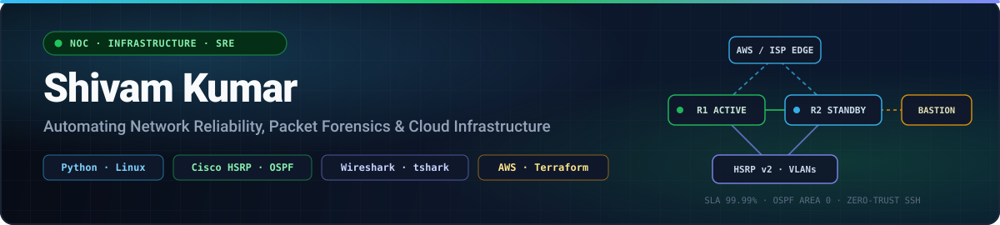

<div align="center">
  
</div>

<p align="center">
  <a href="https://github.com/Shivam-kumar-92">
    
  </a>
  
  
</p>

---

### `whoami` — Engineering Profile

```bash
$ cat /etc/noc/engineer-profile.yml
name:      Shivam Kumar
role:      Network Operations (NOC) | Infrastructure & Cloud Engineer
strengths:
  - Automated network health monitoring, SLA tracking & real-time webhook alerting
  - Packet-level troubleshooting & Root Cause Analysis (DNS, TCP, TLS, ARP)
  - Fault-tolerant Cisco enterprise routing (HSRP v2, OSPF, VLANs, ACLs, DAI)
  - Hardened Linux administration & AWS VPC private-subnet Bastion IaC (Terraform)
```

---

## Featured Production-Grade Projects

<table>
  <tr>
    <td width="50%" valign="top">
      <h3>1. <a href="https://github.com/Shivam-kumar-92/Automated-NOC-Health-Monitor-Alerting-Bot-Highest-Edge-">Automated NOC Health Monitor &amp; Alerting Bot</a></h3>
      <p>
        <a href="https://github.com/Shivam-kumar-92/Automated-NOC-Health-Monitor-Alerting-Bot-Highest-Edge-/actions/workflows/ci.yml">
          
        </a>
        
        
      </p>
      <p>Lightweight Python/Linux monitoring daemon tracking endpoint availability, ICMP latency/packet loss, and TCP ports (<code>22</code>, <code>53</code>, <code>80</code>, <code>443</code>).</p>
      <ul>
        <li><strong>Stateful Alerting:</strong> Anti-flapping hysteresis + instant Discord, Slack &amp; Telegram alerts with Host IP, Down Timestamp &amp; Recovery duration.</li>
        <li><strong>SLA &amp; Ops Ready:</strong> SQLite MTTR tracking, automated CSV/app log rotation, live NOC web dashboard, <code>systemd</code> unit &amp; Docker support.</li>
      </ul>
    </td>
    <td width="50%" valign="top">
      <h3>2. <a href="https://github.com/Shivam-kumar-92/Wireshark-Packet-Capture-Network-Incident-RCA-Portfolio">Wireshark PCAP &amp; Network Incident RCA Portfolio</a></h3>
      <p>
        <a href="https://github.com/Shivam-kumar-92/Wireshark-Packet-Capture-Network-Incident-RCA-Portfolio/actions/workflows/ci.yml">
          
        </a>
        
        
      </p>
      <p>Packet-level troubleshooting &amp; postmortem portfolio across 4 enterprise network incidents — every <code>.pcap</code> verified with zero malformed frames by real <code>tshark</code> in CI.</p>
      <ul>
        <li><strong>4 Deep-Dive RCAs:</strong> DNS <code>NXDOMAIN</code>/<code>SERVFAIL</code> isolation, TCP <code>SYN</code> firewall drop vs. <code>RST</code>, HTTP cleartext vs. TLS 1.2 cert/cipher, and ARP spoofing + Duplicate IP.</li>
        <li><strong>Custom Tooling:</strong> Zero-dependency Python PCAP Forensic Analyzer &amp; NOC Wireshark filter cheat sheet.</li>
      </ul>
    </td>
  </tr>
  <tr>
    <td colspan="2" valign="top">
      <h3>3. <a href="https://github.com/Shivam-kumar-92/High-Availability-Enterprise-Network-Linux-Bastion-Lab-Cisco-AWS-">High-Availability Enterprise Network + Hardened Linux Bastion Lab (Cisco + AWS)</a></h3>
      <p>
        <a href="https://github.com/Shivam-kumar-92/High-Availability-Enterprise-Network-Linux-Bastion-Lab-Cisco-AWS-/actions/workflows/ci.yml">
          
        </a>
        
        
        
      </p>
      <p>Production-mirroring dual-router Cisco campus core paired with a Terraform-provisioned AWS VPC, private subnet, and hardened Ubuntu Linux Bastion architecture.</p>
      <ul>
        <li><strong>Cisco HA Core:</strong> Per-VLAN load-balanced <strong>HSRP v2</strong> with WAN uplink tracking, <strong>OSPF Area 0 (MD5 auth)</strong>, split-scope redundant DHCP, Guest isolation ACLs, Rapid-PVST+, DHCP Snooping, DAI &amp; Port Security.</li>
        <li><strong>AWS &amp; Linux Security:</strong> SG-to-SG SSH chaining, OpenSSH <code>ProxyJump</code>, key-only auth, disabled root login, UFW default-deny, Fail2Ban, <code>sysctl</code> hardening, IMDSv2, encrypted EBS, and SHA-256 verified daily cron backups — validated via <code>shellcheck</code> &amp; <code>terraform validate</code> in CI.</li>
      </ul>
    </td>
  </tr>
</table>

---

## Tech Stack & Operations Toolkit

<p align="center">
  <strong>Networking &amp; Packet Forensics</strong><br />
  
  
  
  
</p>

<p align="center">
  <strong>Cloud, Infrastructure-as-Code &amp; Containers</strong><br />
  
  
  
  
</p>

<p align="center">
  <strong>Systems, Scripting &amp; Security</strong><br />
  
  
  
  
  
</p>

---

## Engineering Principles

| Principle | How I Apply It |
| :--- | :--- |
| **Proactive Detection** | Build automated ICMP, TCP port, latency & SLA monitors with stateful anti-flapping alerts so incidents are caught before user tickets arrive. |
| **Packet-Level Truth** | Go beyond `ping` — diagnose DNS, TCP handshakes, TLS negotiation, and L2 ARP anomalies directly on the wire with documented remediation runbooks. |
| **Defense-in-Depth & HA** | Eliminate single points of failure (HSRP/OSPF/split-scope DHCP) and lock down cloud Linux workloads with private subnets, Bastion `ProxyJump`, UFW, and automated backups. |

---

<div align="center">
  
</div>
